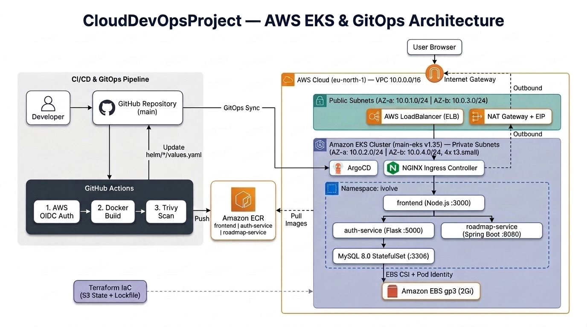
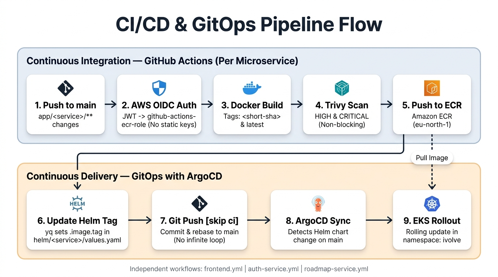

# CloudDevOpsProject

[](https://github.com/marceleno1717/CloudDevOpsProject/actions/workflows/frontend.yml)
[](https://github.com/marceleno1717/CloudDevOpsProject/actions/workflows/auth-service.yml)
[](https://github.com/marceleno1717/CloudDevOpsProject/actions/workflows/roadmap-service.yml)


**Live App:** http://a8ac5225cc32c4a6c9bb51f34d95506c-1770096223.eu-north-1.elb.amazonaws.com

Microservices training app (Node.js frontend, Python/Flask auth service, Java/Spring Boot roadmap service, and MySQL) deployed on AWS EKS in `eu-north-1`.

Infrastructure is managed with Terraform, workloads are packaged with Helm and synced by ArgoCD, and container builds/scans run in GitHub Actions using AWS OIDC (no static IAM keys).

## Architecture



How traffic and networking are wired:
- Worker nodes live in two private subnets across `eu-north-1a` (`10.0.2.0/24`) and `eu-north-1b` (`10.0.4.0/24`), with one EKS managed node group per subnet so nodes are always spread across both AZs.
- Outbound traffic from the private subnets (ECR image pulls, package downloads) goes through a NAT Gateway in public subnet `a`.
- `ingress-nginx` creates an internet-facing AWS Load Balancer in the public subnets (tagged `kubernetes.io/role/elb = 1`) and routes `/` to `frontend:3000`.
- MySQL runs as a `StatefulSet` in the `ivolve` namespace with a 2Gi `gp3` EBS volume provisioned by `aws-ebs-csi-driver`, authenticated using EKS Pod Identity.

### CI/CD & GitOps



Each microservice has its own workflow under `.github/workflows/`. Workflows only trigger when files under `app/<service>/**` change (or via manual dispatch). They authenticate to AWS with OIDC (`github-actions-ecr-role`), build and scan the image with Trivy (`HIGH`/`CRITICAL`, non-blocking), push `<short-sha>` and `latest` to ECR, and update `.image.tag` in `helm/<service>/values.yaml` with `[skip ci]`. ArgoCD picks up the commit and rolls out the new pods.

## Services

| Service | Stack | Port | Notes |
| :--- | :--- | :---: | :--- |
| `frontend` | Node.js 22, Express 5, EJS | 3000 | Login/signup UI, sessions, proxies API calls |
| `auth-service` | Python 3.12, Flask, bcrypt | 5000 | `/api/auth/signup`, `/api/auth/login`, `/health` |
| `roadmap-service` | Java 21, Spring Boot 3.5 | 8080 | Multi-stage Maven build, serves `/api/roadmap` |
| `mysql` | MySQL 8.0 | 3306 | Headless service + StatefulSet (`ivolve` DB) |

## Repo Layout

```text
.github/workflows/   # frontend.yml, auth-service.yml, roadmap-service.yml
app/                 # Service source code and Dockerfiles
compose/             # Local docker compose stack
docs/                # Architecture diagram
helm/                # Helm charts (values.yaml image tags updated by CI)
k8s/                 # Namespace, ebs-sc StorageClass, ConfigMap, Secret, MySQL StatefulSet
terraform/           # S3 backend, VPC, ECR, EKS (+ Pod Identity & EBS CSI), GitHub OIDC role
commands.txt         # Quick command notes
```

## Infrastructure (`terraform/`)

- **State:** S3 backend (`iv-devops-tfstate-bucket`, key `eks-project/terraform.tfstate`, `eu-north-1`) using Terraform's native S3 lockfile (`use_lockfile = true`).
- **VPC (`modules/vpc`):** `10.0.0.0/16`, 2 public subnets (`10.0.1.0/24`, `10.0.3.0/24`) with `kubernetes.io/role/elb = 1`, 2 private subnets (`10.0.2.0/24`, `10.0.4.0/24`), IGW, NAT Gateway + EIP, route tables, and NACL.
- **ECR (`modules/ecr`):** 3 repos (`frontend`, `auth-service`, `roadmap-service`).
- **EKS (`modules/eks`):** Cluster `main-eks` (`1.35`), `API_AND_CONFIG_MAP` auth, two per-AZ node groups (`t3.small`, AL2023, 2 nodes per AZ = 4 total), plus `eks-pod-identity-agent` and `aws-ebs-csi-driver` add-ons bound to `main-eks-ebs-csi-role`.
- **OIDC (`github_oidc.tf`):** `github-actions-ecr-role` with `AmazonEC2ContainerRegistryPowerUser`, scoped to GitHub's immutable subject claim for this repo's `main` branch (`repo:marceleno1717@49311846/CloudDevOpsProject@1459059279:ref:refs/heads/main`).

## Verification

Captured from the running cluster and AWS environment:

### EKS Nodes (Private Subnets Across 2 AZs) & Add-ons

```text
$ kubectl get nodes -o wide
NAME                                        STATUS   ROLES    AGE     VERSION               INTERNAL-IP   EXTERNAL-IP   OS-IMAGE                        CONTAINER-RUNTIME
ip-10-0-2-132.eu-north-1.compute.internal   Ready    <none>   3d4h    v1.35.9-eks-9adbfea   10.0.2.132    <none>        Amazon Linux 2023.12.20261112   containerd://2.3.7+unknown
ip-10-0-2-188.eu-north-1.compute.internal   Ready    <none>   2d23h   v1.35.9-eks-9adbfea   10.0.2.188    <none>        Amazon Linux 2023.12.20261112   containerd://2.3.7+unknown
ip-10-0-4-122.eu-north-1.compute.internal   Ready    <none>   3d4h    v1.35.9-eks-9adbfea   10.0.4.122    <none>        Amazon Linux 2023.12.20261112   containerd://2.3.7+unknown
ip-10-0-4-209.eu-north-1.compute.internal   Ready    <none>   2d23h   v1.35.9-eks-9adbfea   10.0.4.209    <none>        Amazon Linux 2023.12.20261112   containerd://2.3.7+unknown

$ aws eks list-addons --cluster-name main-eks --region eu-north-1
{
    "addons": [
        "aws-ebs-csi-driver",
        "eks-pod-identity-agent"
    ]
}
```

### Pods, Storage & Ingress

```text
$ kubectl get pods -n ivolve -o wide
NAME                                        READY   STATUS    RESTARTS   AGE     IP           NODE
auth-auth-service-655d84b5fc-bmpht          1/1     Running   0          3d      10.0.4.59    ip-10-0-4-122.eu-north-1.compute.internal
auth-service-auth-service-f995c4787-zzd7w   1/1     Running   0          5m51s   10.0.4.13    ip-10-0-4-209.eu-north-1.compute.internal
frontend-frontend-7c85f54b77-bt7vj          1/1     Running   0          6m1s    10.0.2.118   ip-10-0-2-188.eu-north-1.compute.internal
mysql-0                                     1/1     Running   0          2d23h   10.0.2.43    ip-10-0-2-188.eu-north-1.compute.internal
roadmap-roadmap-service-594456974b-pwj2p    1/1     Running   0          5m27s   10.0.4.44    ip-10-0-4-209.eu-north-1.compute.internal

$ kubectl get pvc,ingress -n ivolve
NAME                                       STATUS   VOLUME                                     CAPACITY   ACCESS MODES   STORAGECLASS   AGE
persistentvolumeclaim/mysql-data-mysql-0   Bound    pvc-d8303b18-dbc2-459b-abc0-3cf3e318b9a5   2Gi        RWO            ebs-sc         3d

NAME                                                  CLASS   HOSTS   ADDRESS                                                                    PORTS   AGE
ingress.networking.k8s.io/frontend-frontend-ingress   nginx   *       a8ac5225cc32c4a6c9bb51f34d95506c-1770096223.eu-north-1.elb.amazonaws.com   80      3d
```

### ArgoCD Sync & CI/CD Image Bumps

```text
$ kubectl get applications.argoproj.io -n argocd
NAME           SYNC STATUS   HEALTH STATUS
auth-service   Synced        Healthy
frontend       Synced        Healthy
roadmap        Synced        Healthy

$ grep -H 'tag:' helm/*/values.yaml
helm/auth-service/values.yaml:  tag: 490e342
helm/frontend/values.yaml:  tag: 22de7b3
helm/roadmap-service/values.yaml:  tag: 44f802a

$ git log -n 6 --oneline
672efcb fend
4ccc5ba chore(frontend): update image tag to 22de7b3 [skip ci]
22de7b3 change frontend
a71409f chore(auth-service): update image tag to 490e342 [skip ci]
490e342 chore(roadmap-service): update image tag to 44f802a [skip ci]
453ca76 chore(frontend): update image tag to 44f802a [skip ci]
```

### End-to-End Health Checks

```text
# Public Ingress -> Express frontend
$ curl -sI http://a8ac5225cc32c4a6c9bb51f34d95506c-1770096223.eu-north-1.elb.amazonaws.com
HTTP/1.1 200 OK
Content-Type: text/html; charset=utf-8
X-Powered-By: Express

# In-cluster frontend -> auth-service -> MySQL
$ kubectl exec -n ivolve deploy/frontend-frontend -- wget -qO- http://auth-service:5000/health
{"database":"connected","status":"UP"}
```

<details>
<summary>Terraform managed resources (<code>terraform state list</code> — 36 resources)</summary>

```text
data.aws_iam_openid_connect_provider.github
aws_iam_role.github_actions_ecr
aws_iam_role_policy_attachment.github_actions_ecr_power_user
module.ecrs[0].aws_ecr_repository.main_ecr
module.ecrs[1].aws_ecr_repository.main_ecr
module.ecrs[2].aws_ecr_repository.main_ecr
module.eks.aws_eks_addon.ebs_csi_driver
module.eks.aws_eks_addon.pod_identity_agent
module.eks.aws_eks_cluster.this
module.eks.aws_eks_node_group.nodes["a"]
module.eks.aws_eks_node_group.nodes["b"]
module.eks.aws_eks_pod_identity_association.ebs_csi
module.eks.aws_iam_role.ebs_csi_role
module.eks.aws_iam_role.eks_cluster_role
module.eks.aws_iam_role.eks_node_role
module.eks.aws_iam_role_policy_attachment.eks_cluster_policy
module.eks.aws_iam_role_policy_attachment.eks_cni_policy
module.eks.aws_iam_role_policy_attachment.eks_ebs_csi_policy
module.eks.aws_iam_role_policy_attachment.eks_ecr_readonly
module.eks.aws_iam_role_policy_attachment.eks_vpc_resource_controller
module.eks.aws_iam_role_policy_attachment.eks_worker_node_policy
module.main_vpc.aws_eip.nat_eip
module.main_vpc.aws_internet_gateway.igw
module.main_vpc.aws_nat_gateway.nat_gw
module.main_vpc.aws_network_acl.acl
module.main_vpc.aws_route_table.private-rtb
module.main_vpc.aws_route_table.public-rtb
module.main_vpc.aws_route_table_association.private-rtb-assoc["a"]
module.main_vpc.aws_route_table_association.private-rtb-assoc["b"]
module.main_vpc.aws_route_table_association.public-rtb-assoc["a"]
module.main_vpc.aws_route_table_association.public-rtb-assoc["b"]
module.main_vpc.aws_subnet.private_subnets["a"]
module.main_vpc.aws_subnet.private_subnets["b"]
module.main_vpc.aws_subnet.public_subnets["a"]
module.main_vpc.aws_subnet.public_subnets["b"]
module.main_vpc.aws_vpc.main_vpc
```

</details>

## Running It

**Local (Docker Compose):**
```bash
docker compose -f compose/compose.yaml up --build
```

**AWS / EKS:**
```bash
# 1. Provision AWS infra
cd terraform && terraform init && terraform apply

# 2. Configure kubectl
aws eks update-kubeconfig --region eu-north-1 --name main-eks

# 3. Apply base k8s manifests (namespace, ebs-sc, configmap, secret, mysql)
kubectl apply -f k8s/namespace.yaml
kubectl apply -f k8s/

# 4. Install ingress-nginx
helm repo add ingress-nginx https://kubernetes.github.io/ingress-nginx
helm repo update ingress-nginx
helm upgrade --install ingress-nginx ingress-nginx/ingress-nginx \
  --namespace ingress-nginx --create-namespace

# 5. Install ArgoCD
helm repo add argo https://argoproj.github.io/argo-helm
helm repo update argo
helm upgrade --install argocd argo/argo-cd --namespace argocd --create-namespace
```

For GitHub Actions, set one repository secret:
- `AWS_ROLE_ARN` = `arn:aws:iam::807462092669:role/github-actions-ecr-role` (from `terraform output github_actions_role_arn`).

## Notes & Gotchas Hit Along the Way

- **Ingress `ADDRESS` stayed empty:** Public subnets needed `"kubernetes.io/role/elb" = "1"` before AWS would provision the Load Balancer for `ingress-nginx`.
- **GitHub OIDC trust policy:** Repos created after July 15, 2026 use immutable `sub` claims with numeric owner/repo IDs (`repo:owner@id/repo@id:ref:refs/heads/main`). Using the old `repo:owner/repo:...` format fails `AssumeRoleWithWebIdentity`.
- **Login returning `409 Username already exists`:** `app/frontend/views/auth.ejs` had a stray space in `mode === " login"`, so the login form always posted to `/signup` instead of `/login`.
